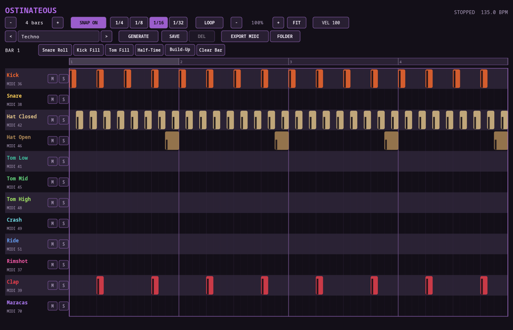

# Ostinateous

> **⚠️ VIBE CODED SLOP.** This entire plugin — DSP, GUI, CI — was built through
> conversational back-and-forth with an AI, not hand-engineered from a spec.
> It works, it's been tested, but go in with appropriate expectations.

A tempo-synced MIDI drum pattern sequencer plugin (VST3 / LV2 / CLAP / JACK
standalone), built on [DPF](https://github.com/DISTRHO/DPF) with a
hand-drawn Cairo-based piano-roll UI — part of the same plugin family as
[Sideous](https://github.com/marcin-koziol/Sideous-synth) and
[Sideous Drums](https://github.com/marcin-koziol/Sideous-drums), with its
own look (light-gray/black/purple/pink) rather than a reskin of either.
Zero audio ports — it emits MIDI only, meant to sit in front of a drum
synth/sampler (like Sideous Drums itself) or record straight into a DAW.



## Grid editing

- Click an empty cell to add a note (snapped to the current grid
  resolution); click-drag to rubber-band select, or Ctrl+click individual
  notes to build up a multi-selection
- Shift+drag paints notes across cells, locked to the row you started in —
  fill a whole bar of 1/16 hi-hats in one stroke
- Drag a note to move it (drags the whole selection together if it's part
  of one), or near its right edge to resize
- A "VEL" box in the toolbar sets the velocity for newly-inserted/painted
  notes (scroll wheel to adjust); scrolling over an existing note adjusts
  *its* velocity instead (and every other selected note's, if it's part of
  a multi-selection) — each note shows a small bar for its current velocity
- Horizontal zoom (toolbar buttons or Ctrl+scroll) and pan (scrollbar or
  plain scroll) once a pattern is too dense to read at 100%
- Per-row **Mute**/**Solo** buttons, standard mixer behavior — while
  anything is soloed, only soloed rows play

## Tempo sync

Reads the host's transport frame position directly (not bar/beat/tick,
which not every host implements as a genuinely incrementing counter) and
schedules sample-accurate note on/offs from it every block, so playback
stays click/stuck-note-free across starts, stops, seeks, and tempo changes.
An optional loop range (drag in the ruler) restricts playback to a
sub-section of the pattern — handy for auditioning just a fill — independent
of whatever loop/cycle behavior the host itself does.

## Patterns, generators, and fills

- Seven factory pattern templates (Techno, House, Minimal Techno, Trance,
  Drum & Bass, Dubstep, Hardstyle) plus your own saved patterns, cycled with
  the `<`/`>` buttons
- **Generate** rolls a fresh, genre-appropriate randomized variation instead
  of just loading the same fixed template every time
- **Save**/**Delete** manage a plain-text pattern library
  (`~/.local/share/ostinateous/patterns`)
- Bar-targeted fills: click a bar number in the ruler to select it as the
  target, then apply Snare Roll / Kick Fill / Tom Fill / Half-Time /
  Build-Up / Clear Bar directly to just that bar

## MIDI export

**Export MIDI** writes a Standard MIDI File of the current pattern straight
to a configurable folder (**Folder** button to change it — click, type,
Enter to confirm) — no native save dialog, since that goes through
`xdg-desktop-portal` over D-Bus and turned out to be unreliable inside a
plugin/bridge process. Defaults to Ardour's own Clips folder
(`~/.local/share/sounds/clips`) if it exists, so anything exported here
shows up in Ardour's Clips panel automatically — point Ardour's own
Preferences → Triggering page at the same folder once and everything from
here is draggable straight onto a track/cue slot.

## Building

```sh
git clone --recursive <repo-url>
cd ostinateous
cmake -S . -B build
cmake --build build -j$(nproc)
```

(If you already cloned without `--recursive`, run
`git submodule update --init --recursive` first.)

Built plugins land in `build/bin/`: `ostinateous.vst3` / `.lv2` / `.clap` /
`ostinateous` (JACK/native standalone). `install.sh [--vst3] [--lv2]
[--clap] [--all]` builds and installs into the standard Linux user plugin
directories.

## License

ISC.
